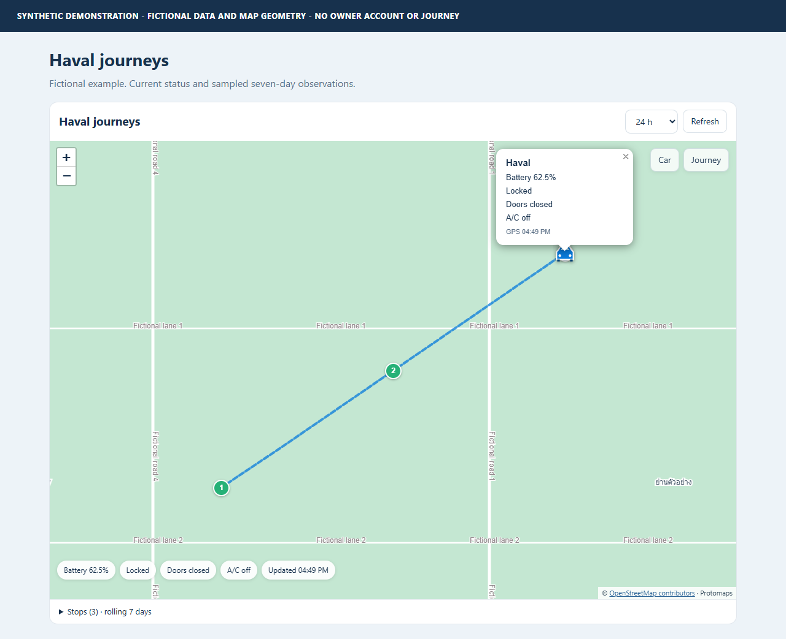
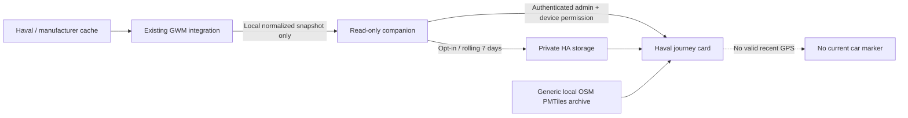
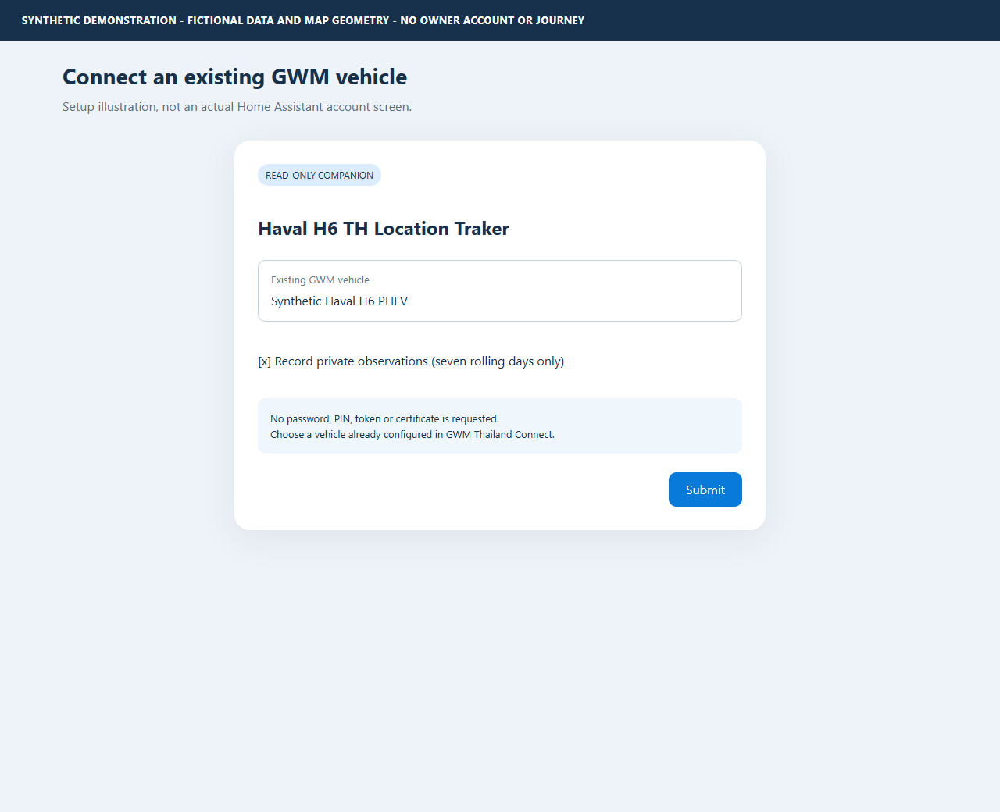

# Haval H6 TH Location Traker

[](https://github.com/zangkasi55/Haval-H6-TH-Location-Traker/actions/workflows/checks.yml)
[](https://github.com/zangkasi55/Haval-H6-TH-Location-Traker/actions/workflows/hacs.yml)
[](https://github.com/zangkasi55/Haval-H6-TH-Location-Traker/actions/workflows/hassfest.yml)
[](LICENSE)

A **read-only Home Assistant companion** for Thailand Haval H6 journeys.
Show the recent car position, battery and door status on a compact local
OpenStreetMap view, with **seven rolling days** of opt-in observations.

**Not a replacement cloud client.** First set up
[GWM Thailand Connect](https://github.com/zangkasi55/gwm-thailand-connect) or a
compatible Thailand `gwm_ora` adapter. This tracker reads its already-loaded
vehicle snapshot. It has **no account login, password, token, certificate, PIN,
vehicle-control service or wake command**.



*Synthetic demonstration only. All positions, events and readings in the
documentation are fictional; no owner's journey or account is shown. The tiny
demo map is fictional test geometry, not a downloadable country basemap.*

## What it does

- Recent car marker and compact battery, lock, doors and A/C status.
- Blank current marker when GPS is missing, invalid or over five minutes old.
- Inferred movement events, stop markers, per-stop battery and sampled door intervals.
- Private, fixed **seven-day** history, pruned even when no new vehicle data arrives.
- Explicit uncertainty: a stopped car is **not automatically parked**.
- Locally bundled Leaflet/Protomaps renderer and a same-host map archive.
- Thai-first city, road, neighbourhood and place-name labels where the local
  archive includes them; optional English-first labels.
- Administrator and selected-source-device permission checks for precise history.
- Existing source integration and dashboard can stay installed; this uses its own
  integration domain and `custom:haval-journey-card` element.

## Start here

1. Read the [installation and setup manual](docs/installation.md).
2. Configure an existing Thailand GWM source integration with location reporting.
3. Install this repository through HACS as an **Integration**, then restart HA.
4. Add **Haval H6 TH Location Traker**, select the existing source vehicle and
   choose whether to enable seven-day recording.
5. Add the module resource and [dashboard card](dashboards/haval-journeys.yaml).
6. Provision a [local OpenStreetMap archive](docs/openstreetmap.md).

```yaml
type: custom:haval-journey-card
map_archive: /local/gwm-maps/thailand.pmtiles
```

HACS custom-repository installation does not require default-catalog inclusion.
See the [HACS submission status](docs/installation.md#hacs-catalog-status);
a submitted PR is not approval.

## Architecture



The tracker never signs into the cloud or requests an extra cloud refresh.
Its **Refresh** button rereads the existing local source cache. The source
integration retains responsibility for normal polling, authentication and
manufacturer timestamp accuracy.

## Parking is deliberately conservative

The required order is:

**stopped -> verified whole-vehicle power on-to-off -> driver door opens ->
driver door closes**, in separate ordered observations in one stationary cluster.

Petrol-engine pauses, locks, passenger doors and elapsed time are **not**
shutdown substitutes. A reference H6 drive supplied fresh GPS/door updates but
no usable canonical whole-vehicle power signal, so parking remained
**unconfirmed**. This release does not claim that every Thailand H6 supplies
that signal. See the [rules and limitations](docs/journeys.md).

## Manual

| Guide | Contents |
| --- | --- |
| [Installation](docs/installation.md) | HACS/manual setup, source compatibility, card resource, options, upgrades and removal |
| [Journeys](docs/journeys.md) | Movement, ordered parking, battery, door intervals, freshness and diagrams |
| [Local OpenStreetMap](docs/openstreetmap.md) | Lawful country archive, attribution and same-host range requests |
| [Troubleshooting](docs/troubleshooting.md) | Blank map, source missing, permissions, stale data and storage failures |
| [Privacy](docs/privacy.md) | Credential boundary, retention, private history and backup responsibilities |
| [Development](docs/development.md) | Stack, build, tests, synthetic screenshots and packaging |



## Compatibility and privacy

- Home Assistant **2026.10 or later**, Python 3.14; installation is a custom
  integration, not part of Home Assistant Core.
- Supported source shapes: `gwm_thailand_connect` normalized coordinators, or
  a Thailand `gwm_ora` entry whose runtime exposes its normalized coordinator.
  Other regions, arbitrary trackers and incompatible snapshots are rejected.
- Live owner data is not bundled. No automatic import of earlier source journey
  history, public coordinate file or fabricated home/default city.
- Do not install a second GWM cloud login for this companion.
- Not a safety, security, anti-theft or continuous GPS tracking system.

## License and affiliation

MIT source with retained upstream attribution; see [LICENSE](LICENSE) and
[NOTICE](NOTICE.md). Bundled map-library licenses and OSM/ODbL attribution are
separate. Haval, GWM, Home Assistant and HACS are interoperability targets;
no affiliation or endorsement is implied.
