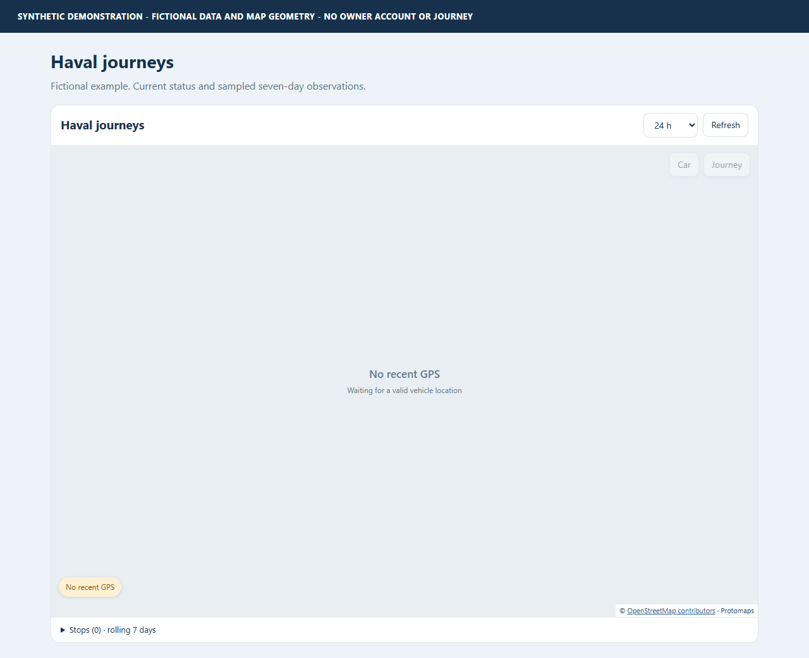

# Installation and setup manual

This package is a **location-only companion**, not a second cloud integration.
It has no credentials, enrollment, certificate extraction or vehicle controls.
All setup pictures are labelled synthetic illustrations.

## 1. Prerequisites

- Home Assistant 2026.10+ and an administrator account.
- An existing configured Thailand vehicle from
  [GWM Thailand Connect](https://github.com/zangkasi55/gwm-thailand-connect) or
  a compatible Thailand `gwm_ora` adapter.
- Vehicle location reporting and a valid source integration session.
- A local OSM archive for map rendering; [instructions](openstreetmap.md).

The source must expose a normalized snapshot with `vehicles`, an internal vehicle
binding, `timestamps.acquisition_time` or `timestamps.update_time`, optional
`location.latitude/longitude` and the documented `values` keys. The companion
reads only those allowlisted fields, not source authentication storage.

The public source coordinator and the legacy adapter's `runtime_data.coordinator`
are supported. Legacy entries must have region `tha`. A raw `device_tracker` or
arbitrary sensor is not silently treated as a supported vehicle.

## 2. Install through HACS

Until catalog inclusion, use HACS **Custom repositories**:

1. Open HACS and choose its menu -> **Custom repositories**.
2. Repository: `https://github.com/zangkasi55/Haval-H6-TH-Location-Traker`.
3. Category: **Integration**.
4. Add, download the latest release, and restart Home Assistant.

Alternatively, open:

[Add custom repository in HACS](https://my.home-assistant.io/redirect/hacs_repository/?owner=zangkasi55&repository=Haval-H6-TH-Location-Traker&category=integration)

### Manual installation

Download a release's source or installable archive. Copy only
`custom_components/haval_h6_th_location_tracker` into your HA configuration's
`custom_components` directory, then restart HA. Do not copy the repository root
into that directory or overwrite the existing GWM integration.

No map country data or owner state belongs inside the installed component.

## 3. Add the tracker

1. Settings -> **Devices & services** -> **Add integration**.
2. Search **Haval H6 TH Location Traker**.
3. Select the **existing GWM vehicle**, not a tracker device from this companion.
4. Choose **Record private observations (seven rolling days only)** if desired.
   The default is off; current position still works when recording is off.
5. Submit. The companion creates a **Journey status** sensor without coordinates
   or route attributes.


One companion entry per selected source device is allowed. To track another
vehicle, add a separate entry. Selecting a different source requires a new entry;
do not repurpose its private history binding.

## 4. Register the dashboard resource

In Settings -> Dashboards -> menu -> **Resources**, add:

- URL: `/haval_h6_th_location_tracker/frontend/haval-journey-card.js?v=1.0.0`
- Type: **JavaScript Module**

Enable Advanced Mode in your HA profile if Resources is not visible.
This is an Integration repository, so HACS does not automatically register it as
a separate dashboard-plugin resource.

Add a dashboard **Manual** card:

```yaml
type: custom:haval-journey-card
map_archive: /local/gwm-maps/thailand.pmtiles
```

The card selects the first companion device and displays a vehicle selector
when more than one exists. To bind a card permanently, set `device_id` to the
**companion** device's HA registry ID, not the original GWM vehicle:

```yaml
type: custom:haval-journey-card
device_id: YOUR_COMPANION_DEVICE_ID
map_archive: /local/gwm-maps/thailand.pmtiles
```

Do not configure `domain: gwm_ora` on this card; that is the predecessor card's
contract. The new card uses its own authenticated companion API.

## 5. Add the map archive

Follow [Local OpenStreetMap](openstreetmap.md). The default file is:

```text
<HA configuration>/www/gwm-maps/thailand.pmtiles
```

A valid current fix must be no more than five minutes old at the manufacturer
source timestamp. Without it, the current marker stays blank. Existing historical
routes remain visible while within retention. No default city/home is invented.



## Operation

- **Refresh** rereads the existing local source snapshot; it never polls/wakes
  the manufacturer directly.
- Source coordinator updates are observed locally; a 30-second local check also
  handles source loading/unloading. No duplicate cloud client is created.
- **Car** centers a valid current fix; **Journey** fits the selected history.
- The history selector offers 12h, 24h, 3d and 7d.
- Open **Stops** or a marker to see sampled battery and door intervals.
- Local history deletion requires checking the confirmation box and pressing
  the explicit deletion button.

## Recording, upgrades and removal

Open the integration's options to enable/disable recording. Retention is always
seven rolling days. Recording continues while enabled; it does not stop at day
seven. Disabling hides history and stops adding samples; expiry still runs.
HA shutdown gaps do not count as observed parked/door-open duration.

For upgrades, use HACS or replace the same component folder, restart HA and
update the resource's version query to the version shown in the new manual.
Existing local history remains subject to its seven-day limit.

To erase history immediately, use the card's confirmed deletion. Removing the
companion config entry deletes its private history. Unloading/disabling is not
equivalent to deletion. Remove the dashboard card/resource before uninstalling
the component. The original source account, polling and vehicle settings are
never removed or changed by this tracker.

Backups have their own retention and may contain private history; manage them
separately. No earlier source-integration history is imported automatically.

## HACS catalog status

This repository is intended for HACS distribution. A release must pass Checks,
Hassfest and HACS validation before a catalog request is submitted.
**Custom-repository installation works independently of catalog review.**
Check the repository's issue/PR links for current submission status; submission,
passing checks and publication are not HACS approval.
