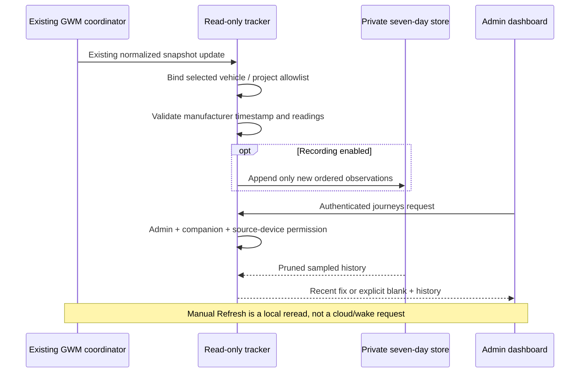
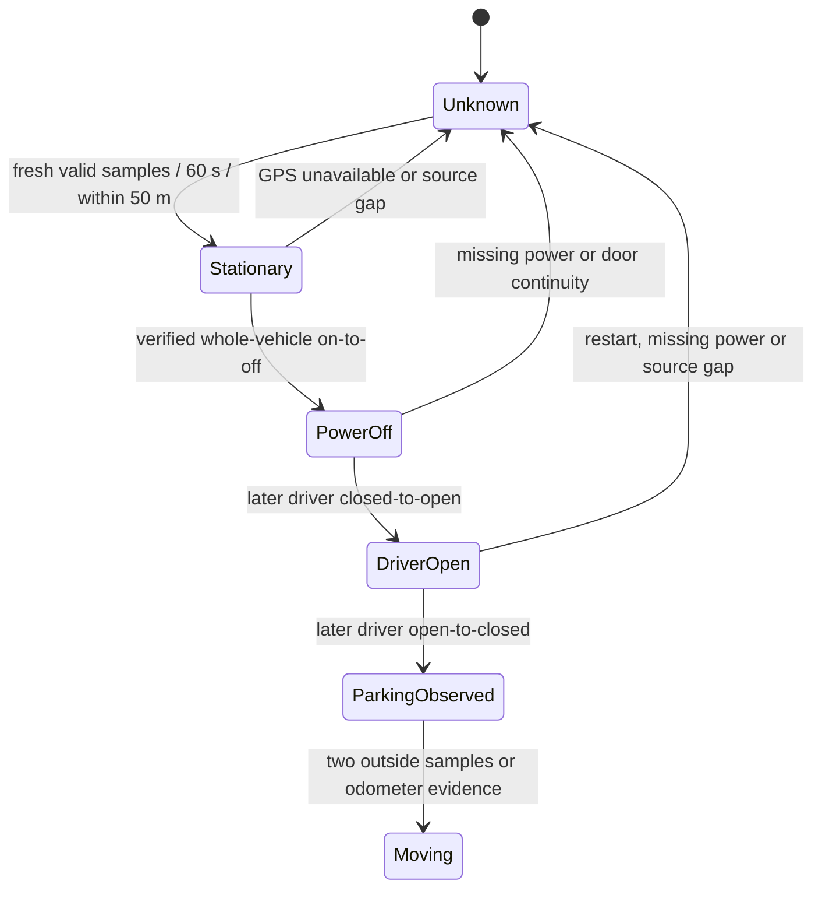
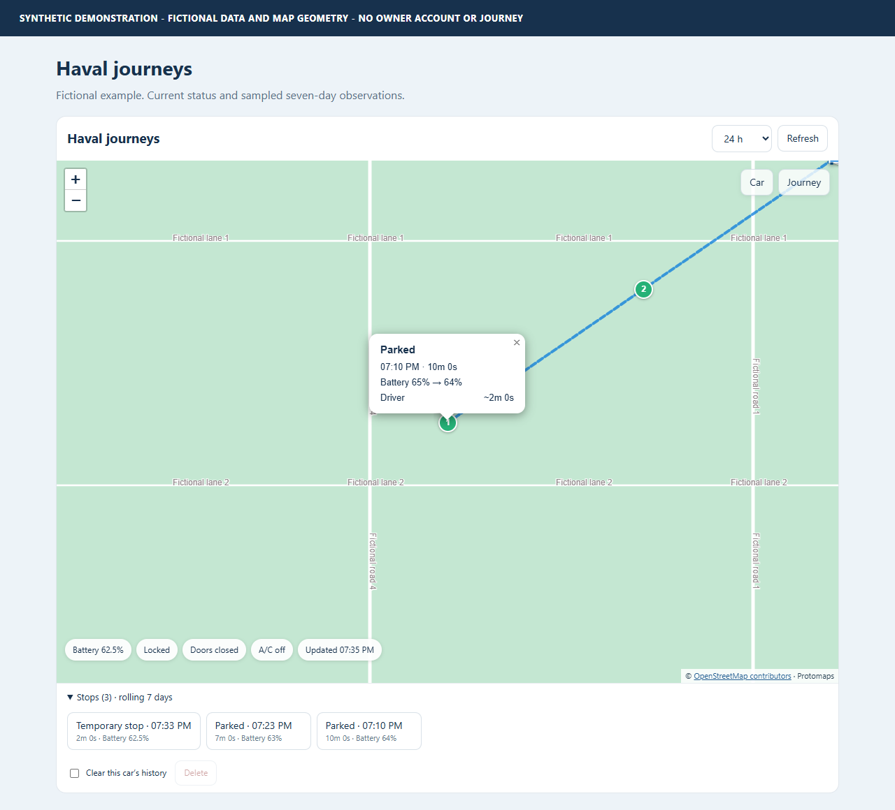

# Journey rules and limitations

Cloud observations are sampled updates, not a continuous GPS feed or a
manufacturer trip log. The tracker starts recording only after opt-in; it never
reconstructs an old journey from today's position.

## Data flow and refresh

Coordinates and private history are not exposed as entity attributes. The status
sensor is only a local health/recording indicator.

## Movement and stops

- At least two valid positions spanning **60 seconds** within **50 metres** form
  a stationary cluster.
- Odometer growth of at least **0.05 km** prevents noisy/frozen GPS from extending
  a stationary cluster.
- Two observations outside the anchor are needed to confirm departure; a single
  GPS outlier is not a journey.
- GPS jumps implying more than **200 km/h** are rejected.
- Positions/arrival/departure times are estimates at observation granularity.
  Short stops can be missed; nearby parking spaces cannot be distinguished.

## Ordered parking rule

| Label | Required evidence |
| --- | --- |
| Temporary stop | Stationary cluster with verified whole-vehicle power on |
| Parking sequence observed | Same stationary cluster: power on-to-off, later driver closed-to-open, later driver open-to-closed |
| Stop / unconfirmed | Stationarity without the full verified sequence |

Locking, a passenger door, an elapsed timer or combustion-engine shutdown does
not replace whole-vehicle power evidence. Shutdown and first driver opening in
one sample have unknown order and do not confirm parking. Starting with the car
already off/open does not invent a transition.

The upstream decoder can supply `values.vehicle_power_off` from explicit canonical
native hybrid `hyEngSts` 0/1 when genuinely available. This companion does not
reinterpret engine codes or invent that field. In a bounded reference Thailand
H6 drive, fresh location and door activity were observed but no usable canonical
whole-vehicle power signal arrived: **parking remained unconfirmed**.

Synthetic examples deliberately contain explicit fictional power transitions to
exercise the classifier. They do not prove physical vehicle compatibility or
that a driver's occupancy/exit was observed.

## Battery and doors

For each stop, show the first sampled SOC, latest sampled SOC and observation
times. Unknown SOC is unknown, not zero.

Door intervals use first observed open to first observed close and separately
show the observed-open span. An initially open door is labelled start-unobserved.
Missing readings, a tracking gap or loss of location breaks continuity without
inventing a closure. Multiple short cycles between updates cannot be recovered.

## Freshness and retention

- Source **acquisition time** takes precedence over backend update time.
- Maximum age: **300 seconds**. Future tolerance: **30 seconds**.
- Missing/non-timezone-aware timestamps, NaN, out-of-bounds GPS and 0,0 do not
  produce a current marker.
- Repeated/out-of-order source timestamps do not extend durations.
- Gaps over **five minutes** break route, stop and door continuity.
- Durations freeze at the last accepted sample; wall-clock waiting is not proof.
- Fixed **seven rolling days**, with expiry timers independent of fresh input,
  startup/read/write pruning and a 20,161-sample per-vehicle safety cap.
- Storage errors are visible and logged without private payloads. Failed writes
  do not become successful in-memory observations; expiry failures retry.

The source integration is responsible for normal cloud polling. Increasing the
tracker's local check rate cannot force a manufacturer cache to become current.
